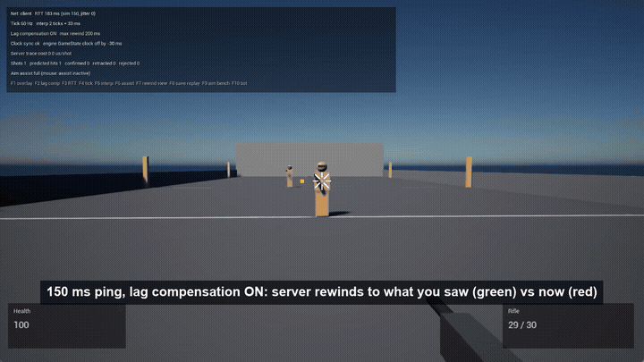
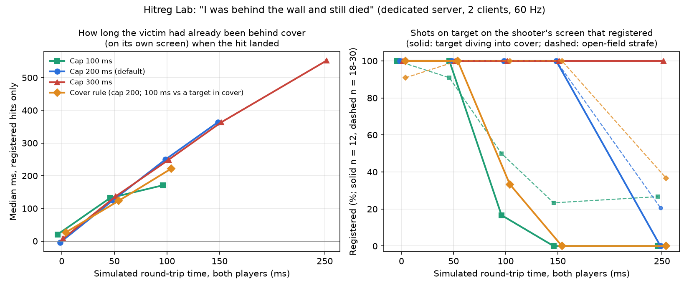
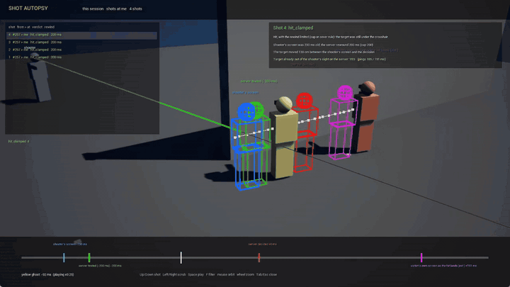
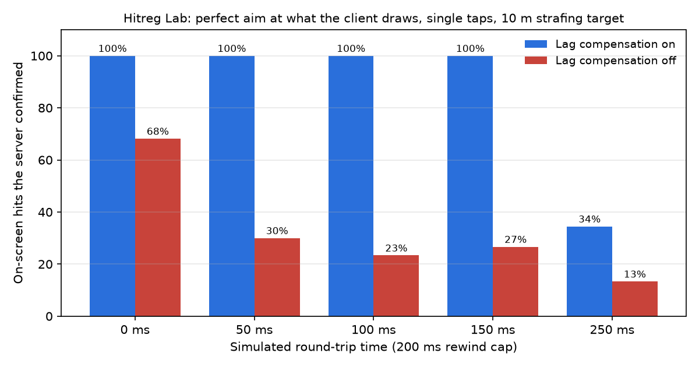
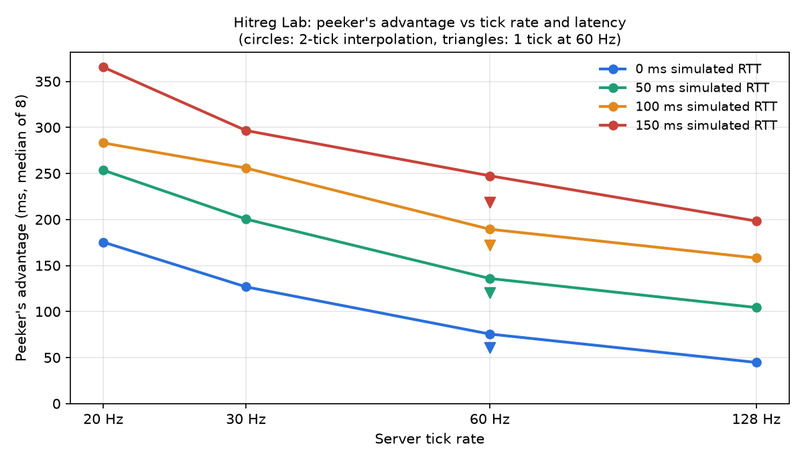

# Hitreg Lab

**A UE5 C++ first-person test range for studying how shots feel and how they register.** It has:
- data-driven weapons;
- controller aim assist;
- client-predicted firing with server-side rewind lag compensation;
- a peeker's-advantage meter;
- a kill cam;
- a **Shot Autopsy**: a server verdict with its reason for every shot, and a viewer to scrub any of them, used to measure "I was behind the wall and still died".

Every system is measured, not just built.

*Unreal Engine 5.8 · C++ · 16 automation tests · dedicated-server measurements · system walkthrough: [docs/WALKTHROUGH.md](docs/WALKTHROUGH.md)*

## Results

**"I was behind the wall and still died."**
- This is the hidden cost of favour-the-shooter lag compensation, and the target pays it. The lab measures it directly.
- The setup ([data](docs/data/cover_sweep.csv)): on a dedicated server with two clients, a runner strafes from the open into cover. The shooter aims perfectly at the runner *as its screen draws it* and fires one shot 10 to 90 cm before the runner's torso leaves that screen. The runner's client records when its own screen lost sight of the shooter, and when the hit reached it. 12 trials per point, 240 in all.
- With the default 200 ms cap, every one of those on-screen shots registered up to 150 ms of round trip. **At 100 ms the hit landed a median 249 ms after the victim's own screen showed them behind the wall (1.5 m past the edge); at 150 ms, 364 ms (2.2 m).** At 0 ms it is about even (median −4 ms).
- At 250 ms the 200 ms cap refuses all of them: the shooter's view (about 305 ms old) is too old. Raise the cap to 300 ms and they all register again, landing 552 ms after the victim reached cover.
- The shooter's view in this setup is RTT + 50 to 70 ms old (the 2-tick interpolation delay, up to a server tick and a frame), so at 150 ms most shots are already traced at the 200 ms cap (`hit_clamped`) and still hit.

**A fairer rule, measured both ways.**
- The **cover rule**: if the target is already out of the shooter's line of sight at its current server position, rewind it at most 100 ms instead of 200. A shooter whose view is younger than 100 ms is never affected, and targets in the open never are.
- In the cover test it stops the late deaths: at 100 ms round trip only 4 of 12 last-moment shots still registered (vs 12 of 12), and at 150 ms none did (vs 12 of 12). **That is also its cost:** those were real hits on the shooter's screen, and the high-ping shooter now loses them.
- Simply lowering the cap to 100 ms does the same in cover (2 of 12, 0 of 12), but it also hurts high-ping shooters against targets in the open. In the open-field bench ([data](docs/data/hitreg_rules.csv)) a 100 ms cap registered 50% of on-screen hits at 100 ms and 23% at 150 ms; the cover rule registered 100% at both, like the default.
- So the rule moves the cost of the last ~100 ms of a high-ping view from the target back to the shooter, and only in the situation players complain about. It doesn't remove the trade-off: Riot's VALORANT netcode article and the Black Ops III GDC talk both treat favour-the-shooter as a deliberate choice of who absorbs latency, and this rule is a different point on that curve, not a free fix. Both rules behave the same below 100 ms because neither touches a younger view.

**Shot Autopsy, counts.** In the cover sweep the server's session log ([summary](docs/data/autopsy_cover_sweep_summary.csv)) recorded 240 shots: 117 `hit`, 45 `hit_clamped`, 45 `miss_capped`, 32 `miss_cover_rule`, 1 `miss_blocked`. 124 of the 162 registered hits were on a target that was already out of the shooter's sight on the server.

**Lag compensation.**
- The setup: a client aims perfectly at the strafing target *as it draws it* and fires single taps.
- The measure: the share of on-screen hits the server confirmed ([data](docs/data/hitreg_bench.csv)).
- With compensation on, every on-screen hit registered up to 150 ms of round trip.
- Without it, 68% registered even at 0 ms (remote players are drawn ~2 ticks in the past), and only 23–30% at real pings.
- At 250 ms the 200 ms rewind cap applies, deliberately, and registration drops to 34%.

**Peeker's advantage.**
- The setup: a scripted peeker strafes past a corner while a holder watches it.
- The measure: the time between when the peeker's screen first shows the holder and when the holder's screen first shows the peeker.
- 160 trials over a dedicated server and two clients ([data](docs/data/peek_sweep.csv)).
- Lag compensation doesn't remove this advantage. Tick rate and interpolation delay shrink it, but round-trip time dominates.

| | 20 Hz | 30 Hz | 60 Hz | 128 Hz | 60 Hz, 1-tick interp |
|---|---|---|---|---|---|
| 0 ms RTT | 175 ms | 127 ms | 76 ms | 45 ms | 61 ms |
| 50 ms | 254 | 200 | 136 | 104 | 121 |
| 100 ms | 283 | 256 | 189 | 158 | 172 |
| 150 ms | 365 | 297 | 247 | 198 | 219 |

**Other measurements** (from the automation tests and the HUD):
- **Server lag-compensation trace:** ~10–200 µs per shot. The analytic hitbox tests are cheap; the world line trace dominates.
- **Clock sync:** ~4 ms error with 40 ms of jitter each way. The engine's own GameState clock was off by 40–70 ms in the same runs.
- **Kill cam recording:** ~670 bytes/s per player.
- **Aim assist (bot-thumb benchmark, 50 seeded trials):** median time to put the crosshair on the head went from 1408 ms (off) to 1308 ms (full), and tracking rose from 11% to 16%. A modest, honest effect. The point is that it's measured.

## Systems

| System | Where | Notes |
|---|---|---|
| Weapons | `Weapons/` | `UHLWeaponDefinition` data assets: fire mode, RPM, falloff, spread bloom, recoil patterns, ADS. Firing is frame-rate independent (`FHLFireClock`). Projectile launcher. |
| Shot pipeline | `UHLWeaponComponent` | The client predicts the hit marker and tracer. `Server_Fire` carries the client's *view time*. The server validates fire rate (token bucket), origin and timestamps, then confirms or retracts the predicted marker. |
| Lag compensation | `Net/HLLagCompensationSubsystem` | Every character's pose is recorded each server frame. Shots are traced against hitboxes rewound to the shooter's view time, capped at 200 ms. Hit tests are analytic (ray-sphere and ray-OBB in `HLHitboxMath`), so nothing has to be teleported. |
| Snapshot interpolation | `AHLCharacter` | Remote players are drawn from timestamped snapshots at `server time - RTT/2 - N ticks`. That render time is exactly what the client reports, so the server rewinds to what the client saw (`HitregLab.Net.Rewind`: within 2 cm). |
| Server clock | `Net/HLServerClockComponent` | NTP-style pings; offset from the lowest-RTT sample, slewed 1 ms per frame. |
| Aim assist | `Aim/` | Radial dead zone and response curve, then slowdown in a bubble sized in cm, then rotational pull (only while the player is giving input), then bullet magnetism. The Aim Assist Tuner editor tab edits it live and runs the benchmark. |
| Peek meter | `Measure/` | Server-orchestrated trials; each client reports first sight in synced server time. `-PeekSweep=N -PeekFull` runs unattended. |
| Hit-reg bench | `Measure/HLHitregBenchComponent` | `-HitregBench=N` on a client: perfect aim at the drawn target, per RTT, with compensation on and off. |
| Shot Autopsy | `Autopsy/` | The server judges every shot and records a verdict with its reason (`hit`, `hit_clamped`, `miss_aim`, `miss_blocked`, `miss_moved`, `miss_capped`, `miss_cover_rule`, `rejected_*`, `projectile`). `TraceShot` also tests the shooter's raw view time, so a miss the shooter saw as a hit names the clamp that caused it. Each record (~460 bytes with a 25 ms track of the target) goes to the shooter's and the victim's clients, into F8 `.hlreplay` files (format v2; v1 still loads) and into `autopsy_*.csv` per session. Tab opens the viewer. |
| Cover rule | `Net/HLRewindRules` | Pure rewind decision: cap, then (optional) at most 100 ms against a target already out of the shooter's sight now. Decided per target in `TraceShot`. F11 or `HLCoverRule 1`. |
| Behind-cover meter | `Measure/HLCoverMeterSubsystem`, `HLCoverComponent` | `-CoverSweep=N` on a dedicated server (peek map): runner into cover, shooter fires at the last on-screen moment, runner times its own loss of sight vs the hit's arrival, across RTT x rewind rule. |
| Kill cam | `Replay/` | A client-side 8 s ring at 30 Hz, quantized to 16 bytes per pose. Played back from the killer's eyes with scrub, pause and slow motion. F8 saves a versioned `.hlreplay` for bug reproduction. |

## Three bugs the measurements caught

1. **The movement component only sends a client's moves to the server when the actor replicates movement.** I had turned replicated movement off to draw remote players from my own snapshots. The peek test showed the peeker moving on its own screen but never on the server. The fix: keep it on, and make simulated proxies ignore the engine's replicated position.
2. **Remote players were rendered at `ServerNow - interp`,** which is *ahead* of the newest snapshot a client can have, since snapshots arrive RTT/2 late. The rewind test caught it once its client buffer only held snapshots that would actually have arrived.
3. **Bots all had player id 0.** Only player controllers get an id from the game session (`AGameSession::RegisterPlayer`), so every bot kept the default. The kill cam keyed its tracks by player id, so the bots merged into one track and the "killer" camera hopped between them every frame. Bots now get ids from the game session, the recorder refuses to merge two characters into one track, and each kill cam logs how far the killer's recorded aim was from the victim at the kill (0.1 to 0.3 degrees after the fix).

## Running it

- **Open:** `HitregLab.uproject` in UE 5.8. Maps: `Lvl_Range` (strafing dummies), `Lvl_Arena` (fight bots), `Lvl_Peek`.
- **Keys:**
  - WASD, mouse or gamepad; LMB/RT fire, RMB/LT ADS, R reload, 1–4 weapons.
  - F1 net overlay, F2 lag compensation, F3 simulated RTT, F4 tick rate, F5 interpolation ticks.
  - F6 aim assist mode, F7 rewind view, F8 save kill cam (with the shot autopsies), F9 aim benchmark, F10 add bot.
  - F11 cover rule, Tab Shot Autopsy viewer (Up/Down shot, Left/Right scrub, Space play, F filter, mouse orbit). `HLAutopsyLoad <file>` reopens a saved `.hlreplay`, `HLAutopsyCsv` writes the session log.
- **Measurements:** two clients and a dedicated server (see `Tools/record_clips.ps1` for the command lines):
  - `-server -PeekSweep=8 -PeekFull -QuitAfterSweep`
  - `-game 127.0.0.1 -HitregBench=30 -QuitAfterBench` (add `-BenchRules` to compare rewind rules)
  - `-server -CoverSweep=12 -QuitAfterSweep` on `Lvl_Peek` with two clients (`Tools/run_measure.ps1 -Mode cover` runs all three)
- **Charts:** `python Tools/plot_peek.py`, `python Tools/plot_hitreg.py` and `python Tools/plot_cover.py`.
- **Tests:** `UnrealEditor-Cmd.exe HitregLab.uproject -ExecCmds="Automation RunTests HitregLab; Quit" -unattended -nullrhi` (16 tests).
- **Content:** the weapon and aim assist assets and the maps are created by `Tools/Content/hl_content.py` (run in the editor). Level geometry is built from code by `AHLLevelBuilder`.

## What I'd do next

- **Measure the cover rule with uneven pings.** The sweep gives both players the same round trip. The interesting case is a 150 ms shooter against a 20 ms victim, where the victim's own screen is furthest ahead of the shooter's.
- **Make the budget depend on something.** 100 ms is a fixed guess. A budget tied to the victim's own round trip, or to how long ago the target crossed the cover edge on the server, could keep more legitimate hits.
- **Partial cover.** The rule only asks whether the head and torso centres are visible. A target half behind a box isn't "in cover" to it; a per-hitbox visibility test would treat that case properly.
- **Show the autopsy to players.** A one-line death recap ("you were hit 249 ms after reaching cover; the shooter's view was 205 ms old") is the kind of thing that turns a rage moment into an explanation.
- **More trials and real networks.** 12 trials per point is enough to see a 100% vs 0% swing, not to resolve small differences. Simulated latency has no packet loss or jitter here; the clock sync and the rewind would both be worth testing under loss.

## References

- Riot Games, "Peeking into VALORANT's Netcode"
- Activision, "Fighting Latency on Call of Duty Black Ops III" (GDC 2016)
- Insomniac Games, "Techniques for Building Aim Assist in Console Shooters" (GDC 2013)
- Blizzard, "Replay Technology in Overwatch: Kill Cam, Gameplay, and Highlights" (GDC 2017)
- Gabriel Gambetta, "Fast-Paced Multiplayer"

## Credits

Directed by Mohammad Mohammad, implemented with Claude Code as an AI coding assistant. Placeholder art is built from engine primitives.
